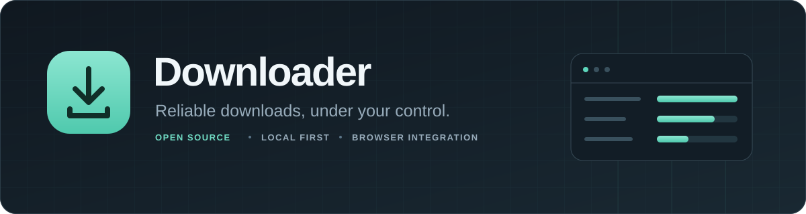
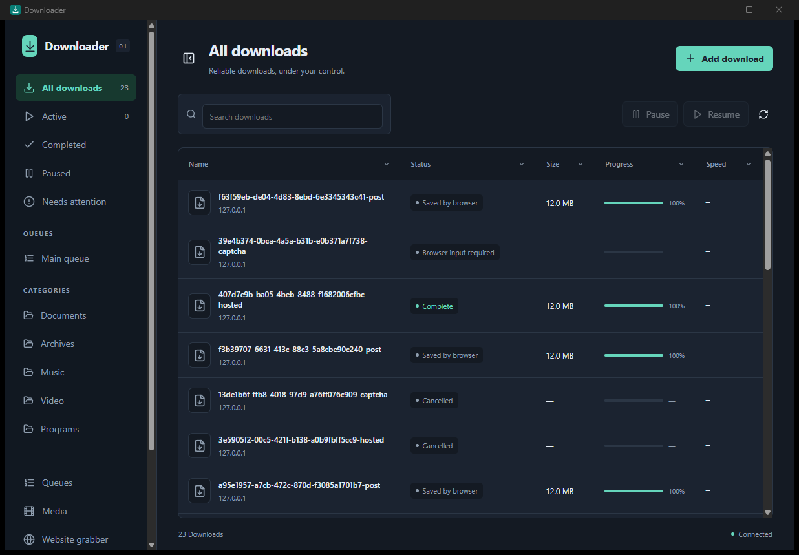
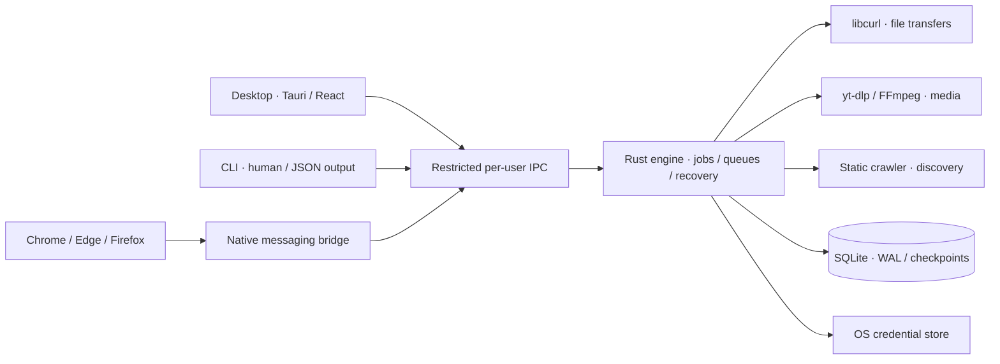

<div align="center">



**An open-source download manager with a native desktop app, a Rust engine, and browser extensions.**

**Version <!-- product-version -->0.9.6<!-- /product-version -->** · [Changelog](CHANGELOG.md) · [Version policy](CONTRIBUTING.md#versioning)

[](https://github.com/gduplessy/Downloader/actions/workflows/ci.yml)
[](LICENSE)
[](docs/IMPLEMENTATION.md)

[Features](#what-you-can-do) · [Build](#build-from-source) · [Browser extension](#connect-your-browser) · [Architecture](#architecture) · [Engine evidence](docs/TRANSFER_ENGINE.md) · [Contribute](#contributing)

</div>

## Downloads you can trust

Downloader is an original, GPL-3.0 alternative to Internet Download Manager. It keeps transfers local and makes recovery visible: downloading, verification, assembly, scanning, and completion have distinct states. Browser downloads stay recoverable if a desktop handoff fails.

No accounts, advertising, or telemetry. Credentials belong in the operating system's credential store; browser session material is temporary.

> **Development preview.** A Windows desktop build and hosted-page browser fixtures have been verified locally. Full IDM parity, installer acceptance, and the complete platform/browser matrix are still in progress. See the [full roadmap](docs/ROADMAP.md), [implementation status](docs/IMPLEMENTATION.md), [acceptance evidence](docs/ACCEPTANCE.md), and [compatibility matrix](docs/COMPATIBILITY.md).

The [NAV implementation plans](docs/plans/nav/README.md) cover remaining hosted-page work, direct browser-response streaming, scoped accounts, scheduling, rendered discovery and custom CAPTCHA. They define six implementation batches with separate worktrees, frequent verified commits and PRs; live host/account and paid-provider acceptance remain separate gates.

The coordinator's shared navigation contracts define session fencing, task/wait metadata, replay disposition and bounded streaming frames. They provide interfaces for the feature branches; their presence does not establish implemented navigation behavior.

The NAV staging branch combines these contracts with versioned adapters and local DOM/request/hash fixtures. Installed extension/native ownership and stream acceptance remain in progress; the [adapter handoff](docs/plans/nav/HANDOFF-ADAPTERS.md) records the integration hooks and evidence limits.

Native stream storage is now staged with scheduler recovery. Queue tasks follow persisted source/claim generations, and recovered tabs report their exact session scope. Installed capture and cross-browser lifecycle acceptance remain in progress.

Wait alarms carry source and wait generations; replaced alarms cannot wake earlier actions. Local scheduler resource and restart evidence is recorded in the [qualification report](docs/evidence/nav-scheduling/README.md).

Latest [qualification records](docs/evidence/transfer-engine-2026-10-11/README.md) include three-platform PAC failover and actual filesystem recovery, plus a disposable Docker AD realm. Nine Linux NTLM/Kerberos checks passed locally and in CI; four additional native Windows NTLM checks passed locally. Native SSO and managed enterprise proxy policies still need acceptance.



<p align="center"><sub>Actual Windows preview, using local download fixtures. No sample production downloads or private session data.</sub></p>

## What you can do

| Capability                     | In the preview                                                                                                                                              |
| :----------------------------- | :---------------------------------------------------------------------------------------------------------------------------------------------------------- |
| **Reliable transfers**         | HTTP/HTTPS, HTTP/2, FTP/FTPS, isolated connection reuse, validated segmentation/fallback, bounded retries, and verified SHA-256.                            |
| **Recover interrupted work**   | Durable SQLite checkpoints, verified resume above 4 GiB, typed recovery actions, and crash-safe no-overwrite publication.                                   |
| **Organize downloads**         | Searchable table, categories, queues, bulk URLs and numbered templates, source refresh, and import/export.                                                  |
| **Connect your browser**       | Chrome/Edge and Firefox extension sources, context menus, opt-in capture, per-site access, exclusions, and browser fallback.                                |
| **Navigate hosted pages**      | Dedicated browser tabs, recognizable free-download controls, countdowns, GET form/session capture, and explicit manual steps.                               |
| **Control bandwidth**          | Configurable concurrency, speed limits, rolling quotas, and queue scheduling. Advanced scheduling remains release work.                                     |
| **Inspect media and websites** | yt-dlp adapter, verified Windows component installation, static crawl selection, and remote ZIP/ZIP64 metadata. These workflows need broader qualification. |
| **Use your language**          | English, French, Spanish, German, Arabic, and Simplified Chinese dictionaries; RTL and light/dark/system themes. Native-language review is pending.         |

### Hosted pages, not just direct links

Some file hosts place the actual download behind several pages. Choose **Navigate download page** in the desktop Add dialog, or use the extension context menu:

```text
Hosted page → free-download step → countdown → final GET link/form
                                                    ↓
                           browser paused → desktop accepted → verified file
```

With FlareSolverr enabled, recognized browser protection receives one automatic resolution attempt. The resolver respects waiting periods and stops for custom CAPTCHA, sign-in, payment, or ambiguous controls. Complete the manual step in the tab, then choose **Continue page navigation**. Non-replayable POST requests and browser-generated blobs remain browser-managed.

Navigation is bounded to three active pages and one page per host. Browser profiles claim navigation jobs exclusively to avoid competing workers. This is a heuristic workflow; changing live sites require separate acceptance testing. Custom CAPTCHA, premium-access and DRM bypass remain unsupported. These limits are tracked explicitly in the [hosted-page and challenge roadmap](docs/ROADMAP.md#1-hosted-download-pages-and-challenges) and [protected-content roadmap](docs/ROADMAP.md#5-media-and-protected-content).

### Optional local FlareSolverr

The local adapter is implemented ([NAV-01](docs/ROADMAP.md#1-hosted-download-pages-and-challenges)); live browser-challenge clearance still needs qualification. Custom/image CAPTCHA adapters, including the g4u click challenge, remain a separate research item (NAV-13).

In **Settings → Networking → FlareSolverr**, test `http://localhost:9191/`, select **Direct** proxy routing, enable the integration and save. The default timeout is 60 seconds; only HTTP loopback root endpoints are supported. Use [the Docker walkthrough](docs/FLARESOLVERR_DOCKER.md) and [pinned Compose file](docker-compose.flaresolverr.yml) to install the qualified service.

Recognized browser protection gets one automatic attempt after opt-in; an ordinary 403 does not trigger solving. **Try FlareSolverr** in desktop job details or the extension popup starts a fresh manual attempt. The service serializes requests, isolates temporary sessions and cookies, uses the matching User-Agent for engine requests, and discards cancelled or stale results. Browser-profile ownership and POST/blob fallback are retained. FlareSolverr handles page resolution; libcurl transfers and verifies file bytes. Solver `status: ok` alone cannot complete a download.

The qualified FlareSolverr 3.4.6 deployment rendered a generated GET link/cookie and completed a 2 MiB SHA-256-verified transfer with range pause/resume. Custom-CAPTCHA and expiry fixtures stopped with zero bytes. **Real Cloudflare challenge clearance, fresh g4u links and downstream hosts remain unqualified.** Login, private/credential-backed navigation, countdowns and unsupported interactions stay manual. The g4u image CAPTCHA requires separate research; no paid solver or external CAPTCHA upload is enabled. See [evidence and limits](docs/FLARESOLVERR_QUALIFICATION.md), [CAPTCHA research](docs/CAPTCHA_RESEARCH.md), and [the implementation plan](docs/FLARESOLVERR_PLAN.md).

## Build from source

Filesystem acceptance can be run with `node scripts/qualify-filesystem.mjs` after building the `qualify_filesystem` Rust example. It creates a bounded disposable image; Windows requires administrator rights and Linux requires loop-mount permission. The optional CI `filesystem` input runs the three-platform matrix. NTFS, HFS+ and ext4 disk-full/permission/cross-volume recovery passed on Windows/macOS/Linux. See the [acceptance record](docs/ACCEPTANCE.md).

### Prerequisites

- **Rust 1.93.1**, pinned by `rust-toolchain.toml`.
- **Node.js 22+** and **pnpm 10.28.2**, pinned in `package.json`.
- Linux runtime routing: `libproxy1v5` for system settings and `libpacparser1` for explicit PAC. DEB dependencies include both; AppImage runtime bundling still needs release qualification.
- The [Tauri 2 platform prerequisites](https://v2.tauri.app/start/prerequisites/), including the native compiler and webview dependencies.

```sh
git clone https://github.com/gduplessy/Downloader.git
cd Downloader
pnpm install --frozen-lockfile
cargo build -p downloader-service -p downloader-cli
node scripts/prepare-sidecar.mjs --debug
pnpm --filter @downloader/desktop exec tauri dev
```

For a production build:

```sh
cargo build --release -p downloader-service -p downloader-cli
node scripts/prepare-sidecar.mjs
pnpm --filter @downloader/desktop exec tauri build
```

The CLI is `target/debug/downloader` or `target/release/downloader`; add `.exe` on Windows. Set `DOWNLOADER_DATA_DIR` to an absolute directory to isolate a test instance. Installer targets are NSIS, DMG, DEB, and AppImage; cross-platform build configuration is not platform acceptance evidence.

## Connect your browser

```sh
pnpm --filter @downloader/extension build
```

| Browser       | Load the development extension                                                                                                          |
| :------------ | :-------------------------------------------------------------------------------------------------------------------------------------- |
| Chrome / Edge | Open `chrome://extensions` / `edge://extensions`, enable Developer mode, and **Load unpacked** from `apps/extension/dist/chromium`.     |
| Firefox       | Open `about:debugging#/runtime/this-firefox`, choose **Load Temporary Add-on**, and select `apps/extension/dist/firefox/manifest.json`. |

Read the Chromium ID from `apps/extension/dist/extension-id.txt`, then register the native host from the desktop integration settings or with the CLI:

```sh
target/debug/downloader register --chrome-id EXTENSION_ID
```

On Windows use `target/debug/downloader.exe`. Registration uses your current user account and configures Chrome, Edge, and Firefox native messaging. Permanent Firefox distribution requires Mozilla signing.

Enable integration in the extension options and grant access to a specific site. Capture is disabled initially; access to all sites is a separate opt-in. The browser download is cancelled only after durable desktop acceptance and a viable transfer. The options page includes native-host diagnostics.

## Media components

The Windows component lock pins official yt-dlp, FFmpeg/ffprobe, and Deno assets by SHA-256. Standalone yt-dlp includes matching EJS components, so a separate Python installation is unnecessary.

```sh
node scripts/components.mjs install /absolute/path/to/components
```

Set the resulting path in **Media components** in the desktop settings. Component replacement retains the previous bundle for rollback. Media tools are currently installed separately; complete assembly/playlist/live fixtures, cross-platform bundles, and corresponding-source distribution remain release gates. See [third-party components](docs/THIRD_PARTY.md).

## CLI

After building, add the CLI directory to your `PATH` or invoke its full path:

```sh
downloader add https://example.com/file.zip --directory /absolute/download/path
downloader add https://example.com/file.zip --sha256 EXPECTED_SHA256
downloader add https://example.com/download-page --navigate
downloader list
downloader --json watch
downloader pause JOB_ID
downloader resume JOB_ID
downloader resume JOB_ID --restart
downloader media https://example.com/video
downloader --json diagnostics
downloader export downloads.json
downloader import downloads.json
downloader quit
```

`--restart` explicitly discards partial bytes. Embedded URL credentials are rejected; saved credentials use the OS keyring. Diagnostics redact sensitive download context.

Recovery actions preserve the primary transfer failure when sibling connections are cancelled, including storage errors that need attention before resuming.

Weak ETags use Last-Modified for resume identity, and actual range responses must match that validator before their bytes are written.

Desktop routing supports direct/manual/system/PAC settings and ordered proxy failover. A fallback to direct access must be present in the resolved route list. Windows explicit PAC rejects a native loopback bypass rather than silently overriding the configured policy; select system/direct routing for those targets. Windows system-proxy protocol maps are case-insensitive; bypass lists match whole hosts, `*`/`?` wildcards and `<local>`. Browser-only proxy/VPN extensions require separate desktop configuration; enterprise routing policies remain a qualification gate.

## Architecture



One background engine owns jobs per signed-in user. Closing the desktop window leaves it in the tray; explicit **Quit** checkpoints and stops work. Control traffic uses a restricted Windows named pipe or Unix-domain socket, with no public HTTP control server. The native bridge restricts browser commands and removes desktop paths/credential metadata from creation, refresh, snapshot and event responses.

| Location          | Responsibility                                                                     |
| :---------------- | :--------------------------------------------------------------------------------- |
| `crates/core`     | Transfers, durable state, scheduling, media/grabber adapters, and validation.      |
| `crates/service`  | Background engine, restricted IPC, native messaging, and host registration.        |
| `crates/cli`      | Download control, inspection, queues, import/export, and diagnostics.              |
| `apps/desktop`    | Tauri 2 shell and React/TypeScript interface.                                      |
| `apps/extension`  | Chromium and Firefox builds, handoff, hosted-page resolver, popup, and settings.   |
| `packages/shared` | Six-language dictionaries and shared UI utilities.                                 |
| `scripts`         | Fixtures, component verification, sidecar preparation, and local evidence tooling. |

## Verification

```sh
cargo fmt --all -- --check
cargo clippy -p downloader-core -p downloader-service -p downloader-cli --all-targets -- -D warnings
cargo test -p downloader-core -p downloader-service -p downloader-cli --features downloader-core/fault-injection
pnpm typecheck
pnpm test
pnpm build
```

The transfer-engine and solver increments add crash, storage, protocol, event-replay, privacy and challenge-lifecycle regressions; **20 TypeScript tests** cover desktop events, utilities/translations, and extension policies. The [engine evidence](docs/TRANSFER_ENGINE.md) records source revisions, real **4.016 GiB** pause/reopen/resume/hash transfers on Windows/macOS/Linux, remote ZIP64 offsets, and **38 networking/benchmark cases**. Real native-messaging/CLI fixtures verify response privacy, duplicate creation, ordered events and service restart on all three platforms. A real browser fixture navigated a free-download step and countdown, carried an HttpOnly session cookie, and produced a hash-verified 12 MiB desktop file. Separate fixtures exercised CAPTCHA pauses and POST fallback. [Solver evidence](docs/FLARESOLVERR_QUALIFICATION.md) records the separate generated 2 MiB rendered-GET transfer and live-site limits.

```sh
node scripts/fixture-server.mjs
```

For protocol and performance fixtures (OpenSSL must be on `PATH`):

```sh
CARGO_TARGET_DIR=.local/engine-target cargo build --release -p downloader-core --example qualify
node scripts/qualify-network.mjs .local/network-qualification --benchmark
node scripts/qualify-network.mjs .local/large-qualification --only large_over_4gib --large
```

On PowerShell, set `$env:CARGO_TARGET_DIR = "$PWD/.local/engine-target"` before building. The large-file run uses over 4 GiB of disk space. `OPENSSL` and `QUALIFY_BINARY` override fixture tooling paths. Local runs record one omitted direct-fallback case that needs the reserved CI hostname; disposable CI runners execute it. See [networking, recovery, protocol, and benchmark details](docs/TRANSFER_ENGINE.md).

Real AD authentication is reproducible with `node scripts/qualify-auth-realm.mjs` and Docker's Linux engine. Thirteen local checks passed: Linux NTLM/Kerberos and Windows NTLM, including complete hash-verified jobs and rejected credentials/missing tickets. The harness creates and cleans up its own realm without changing host domain settings. See [realm setup and acceptance boundaries](docs/AUTH_REALM.md).

The hosted-page loopback fixture serves countdown/session, CAPTCHA, POST, and range/unknown-length cases. It is a test utility, not the application's control interface. CI checks source builds on Windows, macOS, and Ubuntu; its live status is shown above. GUI, installer, and browser acceptance remain separate gates.

## Roadmap

The [complete roadmap](docs/ROADMAP.md) inventories every documented unsupported workflow and missing acceptance gate. Planned implementation, qualification, research, and later-platform items are labeled separately; inclusion does not claim current support.

- **Hosted pages and challenges:** live-host qualification of the implemented FlareSolverr browser-challenge workflow; custom/image CAPTCHA adapter research; login/MFA and session refresh, premium-account integration and bypass feasibility, countdown recovery, ambiguous controls/site adapters, non-replayable POST/blob/one-use downloads, configurable navigation limits, and profile isolation.
- **Transfer engine:** implemented and covered by deterministic fixtures, including pooling, durable recovery, source refresh, typed events, >4 GiB transfers, and measured performance. Ordered PAC failover and real filesystem recovery passed on Windows/macOS/Linux. A disposable AD realm qualifies Windows/Linux NTLM and Linux Kerberos; native macOS/Windows Kerberos, enterprise routing, installer provenance and a successful IDM comparison remain qualification gates.
- **Management:** editable properties/columns, drop target and input workflows, archive qualification, ordered queues, recurring/DST/missed-window schedules, synchronization, unified quotas, and import/export acceptance.
- **Browser integration:** stable Chrome/Edge/Firefox/ESR coverage, capture/session/fallback and worker-restart tests, automatic native-host onboarding, media/page tools, Firefox signing, and extension-store distribution.
- **Media:** deterministic assembly, HLS/DASH, playlists, subtitles/audio extraction/live recording, subprocess recovery, authenticated sessions, bundled cross-platform components, verified updates, and protected-media research.
- **Website grabber:** authenticated/rendered discovery, durable crawl recovery, saved project controls, CSS discovery, offline HTML/CSS rewriting, and scheduled synchronization.
- **Desktop experience:** notifications, sleep inhibition, optional autostart, scanner/completion actions, accessibility, six verified translations including backend text/RTL, integration health, and CLI installation.
- **Public release:** native acceptance on Windows/macOS/Linux, installer upgrade/uninstall, signed updates, dependency/source provenance, SBOMs, release identifiers, and the complete launch matrix.
- **Later targets:** Brave/Opera, Safari, Windows ARM/other architectures, mobile feasibility, legacy protocols/MMS, system-wide interception, and legacy connection management.

Current implemented behavior remains summarized in [IMPLEMENTATION.md](docs/IMPLEMENTATION.md). Local operation, opt-in permissions, credential protection, checksum correctness, and browser fallback remain product requirements as this roadmap expands.

## Contributing

Read [CONTRIBUTING.md](CONTRIBUTING.md), check the [open issues](https://github.com/gduplessy/Downloader/issues), and include deterministic regression fixtures for changes to transfers, recovery, or browser handoff. Name the actual platform/browser tested when reporting acceptance evidence.

## License

Copyright © 2026 Downloader contributors. Original project code, text, and assets are **GPL-3.0-only**, without warranty; see [LICENSE](LICENSE). External components retain their own licenses and corresponding-source requirements.

Downloader is independent of Internet Download Manager and its owners. IDM code, branding, copy, and assets are not included.

## Hosted-page adapters

Bundled versioned adapters inspect exact hosts, reject unsafe/advertising controls and offer a generation-bound, keyboard-accessible selection preview when the browser ownership hook is available. Live g4u, ddownload, Rapidgator and Gofile layouts remain unqualified; provider-specific automation is restricted to local synthetic fixtures. Generic navigation remains conservative. See [adapter maintenance](docs/ADAPTERS.md) and [host matrix](docs/HOST-COMPATIBILITY.md).

Adapter fixture checks: node scripts/nav-fixtures/adapters/qualify.mjs and node scripts/nav-fixtures/adapters/evidence.test.mjs. Build the browser harness with node scripts/nav-fixtures/adapters/build.mjs, then run node scripts/nav-fixtures/adapters/server.mjs on port 18765. Browser DOM/hash fixtures use gstack browse; they do not qualify live provider layouts or native transfer ownership. The read-only live-smoke command requires an explicit permitted URL and local gstack binary.

### Navigation scheduling foundation

The service scheduler persists host reservations, tab leases, queue ordering, and wait observations. The default is three navigation tabs with a validated limit of one through twenty. Deadlines trigger page revalidation; elapsed time alone never authorizes a download submission. Installed browser acceptance and combined source/session fencing remain pending.

Navigation queue controls are available in extension options: change the one-through-twenty tab limit, pause/resume admission, adjust priority, continue manual work, and cancel owned tasks. Readiness notifications are opt-in and require notification permission. All unqualified hosts retain their owning tab and a serial host lock during waits; missing tabs require Continue rather than automatic session replacement. Private queue tasks are not persisted by the service.

Browser streams support owner-fenced durable original-response writes, bounded acknowledgements, verification and no-overwrite publication. Stable Chrome and Edge local capture-module/native transport checks completed POST and blob files with matching hashes; the full installed worker/preview route and actual Firefox capture remain pending. See [stream qualification and handoff](docs/NAV_BROWSER_STREAMS.md). Existing private database history is not sanitized by this release; new private task/stream metadata stays in memory and requires reauthorization after service loss.

NAV-04 / NAV-10 local scheduler implementation and fixture evidence are available in [scheduler qualification](docs/evidence/nav-scheduling/README.md). Navigation defaults to three active tabs, supports limits of one through twenty, retains serial host locks and revalidates page readiness after durable waits. Persisted ownership reconciliation with NAV-11 and stable-browser/live-host qualification remain pending.

Final local adapter evidence is recorded under [NAV adapter qualification](docs/evidence/nav-adapters/README.md): 120 Headless Chromium DOM/request/hash checks, with live providers and combined native handoff still separately pending.

Preview cancellation is now lifetime-bound across async authorization. Real-resolver mock-worker fixtures verify intended-file success and no submission after Cancel/claim takeover; combined installed-extension worker qualification is owned by the integration coordinator.

A bounded one-use authorization registry now separates inspection from capture side effects and rejects stale session/document grants. Production worker prepare/commit/cancel wiring remains an integration check.

The native selection command now retains an explicitly chosen downstream host and bundled adapter identity within the current session/source. Private selections stay transient; production worker selection dispatch remains part of combined acceptance.

Direct browser streaming (0.7.1) is off by default. Original POST and page Blob bytes completed through the native receiver in local stable Chrome/Edge fixtures; integrated preview and Firefox/private/container/live-provider acceptance remain pending. See [stream evidence and contracts](docs/NAV_BROWSER_STREAMS.md).

Shared integration 0.8.10: adapter actions now prepare one-use authorization before capture, recheck current page/session/source authority before commit, and abort cancelled capture. Selected provider metadata is recorded through the scoped native command; rendered-discovery navigation opens the selected resource while retaining its provenance page. Full installed-worker acceptance remains pending.

Shared integration 0.8.11: same-context read-only authority renewal adopts claim/source replacements and invalidates old grants/capture. Recovery, heartbeat and tab closure require current browser epoch and actual owned session; stale tab IDs do not authorize a substituted context. Scoped refreshed sources remain in browser navigation until replay qualification. Installed-worker/private-session acceptance remains pending.

Shared integration 0.8.12: private and regular scheduler responses and reconciliation are isolated by explicit worker lane, while capacity and host locks remain service-global. Six native scheduler regressions cover lane isolation, retained peer leases, durable private exclusion, authority replacement and queue recovery.

Scoped browser-account controls are available under Settings. Select an owned browser job and exact session before saving or selecting account metadata. Passwords use the OS credential store; private sessions use existing browser accounts only. Browser login/premium fixture qualification is being integrated; live provider layouts and APIs remain pending.

Account grant and credential lifecycle qualification (0.9.1): Windows OS-keyring save/read/remove and the production Engine one-use grant path pass with deleted test-only credentials. Form cancellation, request overrides and stale documents are covered by real Headless Chromium DOM checks with mocked grant transport. Installed-extension/native downstream acceptance and live/provider account qualification remain pending.

Account browser wiring (0.9.2) uses the owned resolver context for observations and one-use login fills, native selected-session entitlement checks, visible recovery, exact document/source/claim fencing, and cancellation. Combined installed-worker/file-publication qualification is in progress; no live provider or API qualification is claimed.

Account authority integration (0.9.4) adopts intentional source/claim changes only in the original session, supports explicit saved-account edits, validates actual Chromium document identity before grants, and rechecks premium account/revision at capture commit. Owned authenticated observations retain original provenance across redirects. Installed worker qualification is in progress.

Account integration (0.9.5) uses canonical native/browser partition comparison and the exact scheduler private lane. Installed production worker authentication/premium acceptance is being qualified with local permitted files.

Selected account recovery (0.9.6) preserves an explicit account only through same-session owner continuation/refresh, renews nonsecret association fences, invalidates earlier grants and observations, and retains bounded sign-in attempts. Installed worker authentication/premium acceptance remains in progress.
