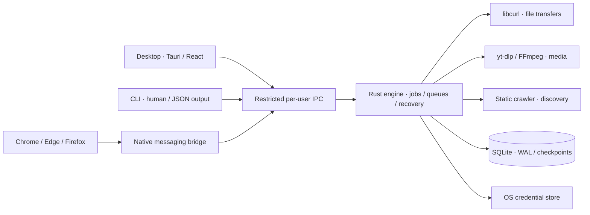

<div align="center">


**An open-source download manager with a native desktop app, a Rust engine, and browser extensions.**

**Version <!-- product-version -->0.2.1<!-- /product-version -->** · [Changelog](CHANGELOG.md) · [Version policy](CONTRIBUTING.md#versioning)

[](https://github.com/gduplessy/Downloader/actions/workflows/ci.yml)
[](LICENSE)
[](docs/IMPLEMENTATION.md)

[Features](#what-you-can-do) · [Build](#build-from-source) · [Browser extension](#connect-your-browser) · [Architecture](#architecture) · [Engine evidence](docs/TRANSFER_ENGINE.md) · [Contribute](#contributing)

</div>

## Downloads you can trust

Downloader is an original, GPL-3.0 alternative to Internet Download Manager. It keeps transfers local and makes recovery visible: downloading, verification, assembly, scanning, and completion have distinct states. Browser downloads stay recoverable if a desktop handoff fails.

No accounts, advertising, or telemetry. Credentials belong in the operating system's credential store; browser session material is temporary.

> **Development preview.** A Windows desktop build and hosted-page browser fixtures have been verified locally. Full IDM parity, installer acceptance, and the complete platform/browser matrix are still in progress. See the [full roadmap](docs/ROADMAP.md), [implementation status](docs/IMPLEMENTATION.md), [acceptance evidence](docs/ACCEPTANCE.md), and [compatibility matrix](docs/COMPATIBILITY.md).


<p align="center"><sub>Actual Windows preview, using local download fixtures. No sample production downloads or private session data.</sub></p>

## What you can do

| Capability                     | In the preview                                                                                                                                              |
| :----------------------------- | :---------------------------------------------------------------------------------------------------------------------------------------------------------- |
| **Reliable transfers**         | HTTP/HTTPS, HTTP/2, FTP/FTPS, isolated connection reuse, validated segmentation/fallback, bounded retries, and verified SHA-256.                           |
| **Recover interrupted work**   | Durable SQLite checkpoints, verified resume above 4 GiB, typed recovery actions, and crash-safe no-overwrite publication.                                            |
| **Organize downloads**         | Searchable table, categories, queues, bulk URLs and numbered templates, source refresh, and import/export.                                                  |
| **Connect your browser**       | Chrome/Edge and Firefox extension sources, context menus, opt-in capture, per-site access, exclusions, and browser fallback.                                |
| **Navigate hosted pages**      | Dedicated browser tabs, recognizable free-download controls, countdowns, GET form/session capture, and explicit manual steps.                               |
| **Control bandwidth**          | Configurable concurrency, speed limits, rolling quotas, and queue scheduling. Advanced scheduling remains release work.                                     |
| **Inspect media and websites** | yt-dlp adapter, verified Windows component installation, static crawl selection, and remote ZIP/ZIP64 metadata. These workflows need broader qualification. |
| **Use your language**          | English, French, Spanish, German, Arabic, and Simplified Chinese dictionaries; RTL and light/dark/system themes. Native-language review is pending.         |

### Hosted pages, not just direct links

Some file hosts place the actual download behind several pages. Choose **Navigate download page** in the desktop Add dialog, or use the extension context menu:

```text
Hosted page → free-download step → countdown → final GET link/form
                                                    ↓
                           browser paused → desktop accepted → verified file
```

The resolver respects waiting periods and stops for CAPTCHA, sign-in, payment, or ambiguous controls. Complete the manual step in the tab, then choose **Continue page navigation**. Non-replayable POST requests and browser-generated blobs remain browser-managed.

Navigation is bounded to three active pages and one page per host. Browser profiles claim navigation jobs exclusively to avoid competing workers. This is a heuristic workflow, not universal site automation; changing live sites require separate acceptance testing. There is currently no CAPTCHA, premium-access, or DRM bypass. These limits are tracked explicitly in the [hosted-page and challenge roadmap](docs/ROADMAP.md#1-hosted-download-pages-and-challenges) and [protected-content roadmap](docs/ROADMAP.md#5-media-and-protected-content).

## Build from source

### Prerequisites

- **Rust 1.93.1**, pinned by `rust-toolchain.toml`.
- **Node.js 22+** and **pnpm 10.28.2**, pinned in `package.json`.
- Linux runtime routing: `libproxy1v5` for system settings and `libpacparser1` for explicit PAC. DEB dependencies include both; AppImage runtime bundling still needs release qualification.
- The [Tauri 2 platform prerequisites](https://v2.tauri.app/start/prerequisites/), including the native compiler and webview dependencies.

```sh
git clone https://github.com/gduplessy/Downloader.git
cd Downloader
pnpm install --frozen-lockfile
cargo build -p downloader-service -p downloader-cli
node scripts/prepare-sidecar.mjs --debug
pnpm --filter @downloader/desktop exec tauri dev
```

For a production build:

```sh
cargo build --release -p downloader-service -p downloader-cli
node scripts/prepare-sidecar.mjs
pnpm --filter @downloader/desktop exec tauri build
```

The CLI is `target/debug/downloader` or `target/release/downloader`; add `.exe` on Windows. Set `DOWNLOADER_DATA_DIR` to an absolute directory to isolate a test instance. Installer targets are NSIS, DMG, DEB, and AppImage; cross-platform build configuration is not platform acceptance evidence.

## Connect your browser

```sh
pnpm --filter @downloader/extension build
```

| Browser       | Load the development extension                                                                                                          |
| :------------ | :-------------------------------------------------------------------------------------------------------------------------------------- |
| Chrome / Edge | Open `chrome://extensions` / `edge://extensions`, enable Developer mode, and **Load unpacked** from `apps/extension/dist/chromium`.     |
| Firefox       | Open `about:debugging#/runtime/this-firefox`, choose **Load Temporary Add-on**, and select `apps/extension/dist/firefox/manifest.json`. |

Read the Chromium ID from `apps/extension/dist/extension-id.txt`, then register the native host from the desktop integration settings or with the CLI:

```sh
target/debug/downloader register --chrome-id EXTENSION_ID
```

On Windows use `target/debug/downloader.exe`. Registration uses your current user account and configures Chrome, Edge, and Firefox native messaging. Permanent Firefox distribution requires Mozilla signing.

Enable integration in the extension options and grant access to a specific site. Capture is disabled initially; access to all sites is a separate opt-in. The browser download is cancelled only after durable desktop acceptance and a viable transfer. The options page includes native-host diagnostics.

## Media components

The Windows component lock pins official yt-dlp, FFmpeg/ffprobe, and Deno assets by SHA-256. Standalone yt-dlp includes matching EJS components, so a separate Python installation is unnecessary.

```sh
node scripts/components.mjs install /absolute/path/to/components
```

Set the resulting path in **Media components** in the desktop settings. Component replacement retains the previous bundle for rollback. Media tools are currently installed separately; complete assembly/playlist/live fixtures, cross-platform bundles, and corresponding-source distribution remain release gates. See [third-party components](docs/THIRD_PARTY.md).

## CLI

After building, add the CLI directory to your `PATH` or invoke its full path:

```sh
downloader add https://example.com/file.zip --directory /absolute/download/path
downloader add https://example.com/file.zip --sha256 EXPECTED_SHA256
downloader add https://example.com/download-page --navigate
downloader list
downloader --json watch
downloader pause JOB_ID
downloader resume JOB_ID
downloader resume JOB_ID --restart
downloader media https://example.com/video
downloader --json diagnostics
downloader export downloads.json
downloader import downloads.json
downloader quit
```

`--restart` explicitly discards partial bytes. Embedded URL credentials are rejected; saved credentials use the OS keyring. Diagnostics redact sensitive download context.

Desktop routing supports direct/manual/system/PAC settings. Windows manual system-proxy bypass lists match whole hosts, `*`/`?` wildcards and `<local>`. Browser-only proxy/VPN extensions require separate desktop configuration; enterprise routing policies remain a qualification gate.

## Architecture



One background engine owns jobs per signed-in user. Closing the desktop window leaves it in the tray; explicit **Quit** checkpoints and stops work. Control traffic uses a restricted Windows named pipe or Unix-domain socket, with no public HTTP control server. The native bridge restricts browser commands and removes local destinations/settings from browser snapshots.

| Location          | Responsibility                                                                     |
| :---------------- | :--------------------------------------------------------------------------------- |
| `crates/core`     | Transfers, durable state, scheduling, media/grabber adapters, and validation.      |
| `crates/service`  | Background engine, restricted IPC, native messaging, and host registration.        |
| `crates/cli`      | Download control, inspection, queues, import/export, and diagnostics.              |
| `apps/desktop`    | Tauri 2 shell and React/TypeScript interface.                                      |
| `apps/extension`  | Chromium and Firefox builds, handoff, hosted-page resolver, popup, and settings.   |
| `packages/shared` | Six-language dictionaries and shared UI utilities.                                 |
| `scripts`         | Fixtures, component verification, sidecar preparation, and local evidence tooling. |

## Verification

```sh
cargo fmt --all -- --check
cargo clippy -p downloader-core -p downloader-service -p downloader-cli --all-targets -- -D warnings
cargo test -p downloader-core -p downloader-service -p downloader-cli --features downloader-core/fault-injection
pnpm typecheck
pnpm test
pnpm build
```

The transfer-engine increment adds crash, storage, protocol, event-replay, and privacy regressions; **18 TypeScript tests** cover desktop events, utilities/translations, and extension policies. The [engine evidence](docs/TRANSFER_ENGINE.md) records exact Rust/CI results, a real **4.016 GiB** pause/reopen/resume/hash run, remote ZIP64 offsets, and **38 networking/benchmark cases**. The CLI/service lifecycle has also been exercised over real restricted IPC. A real browser fixture navigated a free-download step and countdown, carried an HttpOnly session cookie, and produced a hash-verified 12 MiB desktop file. Separate fixtures exercised CAPTCHA pauses and POST fallback.

```sh
node scripts/fixture-server.mjs
```

For protocol and performance fixtures (OpenSSL must be on `PATH`):

```sh
CARGO_TARGET_DIR=.local/engine-target cargo build --release -p downloader-core --example qualify
node scripts/qualify-network.mjs .local/network-qualification --benchmark
node scripts/qualify-network.mjs .local/large-qualification --only large_over_4gib --large
```

On PowerShell, set `$env:CARGO_TARGET_DIR = "$PWD/.local/engine-target"` before building. The large-file run uses over 4 GiB of disk space. `OPENSSL` and `QUALIFY_BINARY` override fixture tooling paths. See [networking, recovery, protocol, and benchmark details](docs/TRANSFER_ENGINE.md).

The hosted-page loopback fixture serves countdown/session, CAPTCHA, POST, and range/unknown-length cases. It is a test utility, not the application's control interface. CI checks source builds on Windows, macOS, and Ubuntu; its live status is shown above. GUI, installer, and browser acceptance remain separate gates.

## Roadmap

The [complete roadmap](docs/ROADMAP.md) inventories every documented unsupported workflow and missing acceptance gate. Planned implementation, qualification, research, and later-platform items are labeled separately; inclusion does not claim current support.

- **Hosted pages and challenges:** CAPTCHA automation/bypass research, login/MFA and session refresh, premium-account integration and bypass feasibility, countdown recovery, ambiguous controls/site adapters, non-replayable POST/blob/one-use downloads, configurable navigation limits, and profile isolation.
- **Transfer engine:** implemented and covered by deterministic fixtures, including pooling, durable recovery, source refresh, typed events, >4 GiB transfers, and measured performance. External NTLM/Kerberos realms, native filesystem matrices, and a successful IDM comparison remain qualification gates.
- **Management:** editable properties/columns, drop target and input workflows, archive qualification, ordered queues, recurring/DST/missed-window schedules, synchronization, unified quotas, and import/export acceptance.
- **Browser integration:** stable Chrome/Edge/Firefox/ESR coverage, capture/session/fallback and worker-restart tests, automatic native-host onboarding, media/page tools, Firefox signing, and extension-store distribution.
- **Media:** deterministic assembly, HLS/DASH, playlists, subtitles/audio extraction/live recording, subprocess recovery, authenticated sessions, bundled cross-platform components, verified updates, and protected-media research.
- **Website grabber:** authenticated/rendered discovery, durable crawl recovery, saved project controls, CSS discovery, offline HTML/CSS rewriting, and scheduled synchronization.
- **Desktop experience:** notifications, sleep inhibition, optional autostart, scanner/completion actions, accessibility, six verified translations including backend text/RTL, integration health, and CLI installation.
- **Public release:** native acceptance on Windows/macOS/Linux, installer upgrade/uninstall, signed updates, dependency/source provenance, SBOMs, release identifiers, and the complete launch matrix.
- **Later targets:** Brave/Opera, Safari, Windows ARM/other architectures, mobile feasibility, legacy protocols/MMS, system-wide interception, and legacy connection management.

Current implemented behavior remains summarized in [IMPLEMENTATION.md](docs/IMPLEMENTATION.md). Local operation, opt-in permissions, credential protection, checksum correctness, and browser fallback remain product requirements as this roadmap expands.

## Contributing

Read [CONTRIBUTING.md](CONTRIBUTING.md), check the [open issues](https://github.com/gduplessy/Downloader/issues), and include deterministic regression fixtures for changes to transfers, recovery, or browser handoff. Name the actual platform/browser tested when reporting acceptance evidence.

## License

Copyright © 2026 Downloader contributors. Original project code, text, and assets are **GPL-3.0-only**, without warranty; see [LICENSE](LICENSE). External components retain their own licenses and corresponding-source requirements.

Downloader is independent of Internet Download Manager and its owners. IDM code, branding, copy, and assets are not included.
